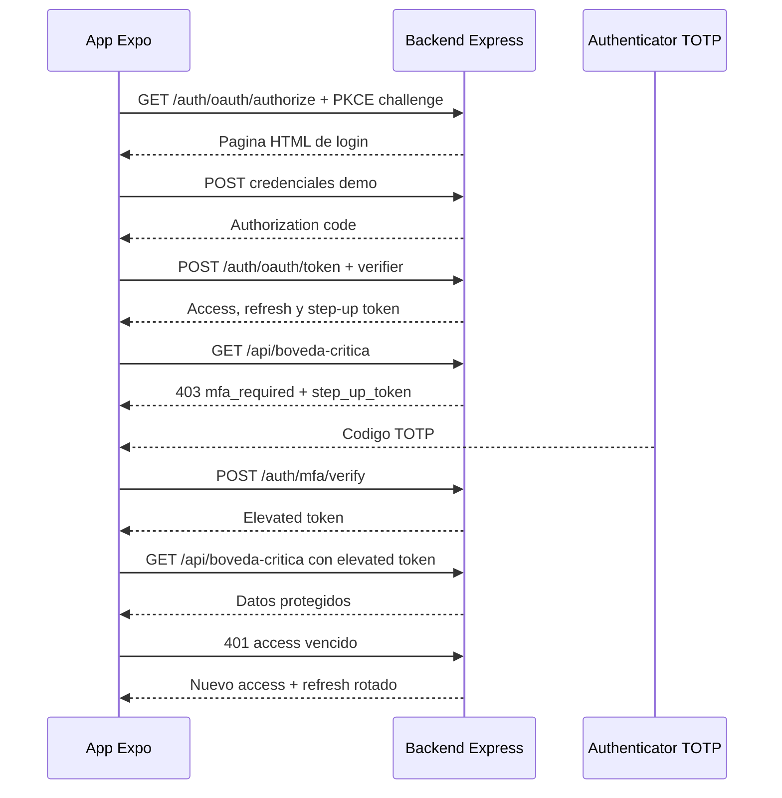

# Taller TOTP y autenticacion reforzada

Proyecto educativo con backend Express y app Expo para demostrar OAuth 2.0 con PKCE, TOTP, tokens JWT, silent refresh y acceso elevado a una boveda critica.

## Arquitectura del flujo



## Requisitos

- Windows con Node.js 24 o superior y npm
- Expo CLI mediante `npx`
- Expo Go en un dispositivo Android o iOS
- El dispositivo y el equipo deben estar en la misma red Wi-Fi
- Puerto `4200` disponible

## Backend

```powershell
cd "C:\Users\Usuario\Desktop\Taller TOTP 1\autenticador\backend"
copy .env.example .env
npm install
npm run dev
```

El backend escucha en `0.0.0.0:4200`. Obtén la IP con:

```powershell
ipconfig
```

Para esta demostracion la app usa `http://192.168.40.11:4200`. Si cambia la IP, actualiza [`.env`](autenticador/app/.env) y reinicia Expo.

Permite el puerto en el firewall de Windows:

```powershell
netsh advfirewall firewall add rule name="Backend TOTP 4200" dir=in action=allow protocol=TCP localport=4200
```

## App Expo

```powershell
cd "C:\Users\Usuario\Desktop\Taller TOTP 1\autenticador\app"
npm install
npx expo start
```

Abre la app desde Expo Go. Configuracion: [`.env`](autenticador/app/.env).

En Expo Go el redirect puede ser `exp://<IP>:<puerto>/--/oauth/callback`; en un build o deep link configurado se usa `unisabana-auth://oauth/callback`. El backend acepta ambos flows de demostracion segun los datos enviados por la app.

## Credenciales demo

- Usuario: `demo`
- Contraseña: `demo`

La semilla TOTP compartida es `JBSWY3DPEHPK3PXP`. Tambien puedes abrir `http://192.168.40.11:4200/dev/qr` para escanearla desde el telefono.

## Tests y smoke test

```powershell
cd autenticador\backend
npm run build
npm test
npm run smoke

cd ..\app
npx tsc --noEmit
npm test
```

`npm run smoke` requiere que el backend ya esté iniciado.

## Implementacion por requisito

- Express, TypeScript y rutas OAuth: `autenticador/backend/src`
- PKCE/Base32/TOTP del backend: `autenticador/backend/src/helpers`
- HMAC manual, Base32 y TOTP de React Native: `autenticador/app/src/security`
- Redux, restore y MFA: `autenticador/app/src/state`
- Cola clásica de silent refresh: `autenticador/app/src/services/api.ts`
- Almacenamiento seguro: `autenticador/app/src/services/tokenVault.ts`
- Inicio OAuth y callback: `autenticador/app/src/services/oauthService.ts`, `autenticador/app/src/app/oauth/callback.tsx`
- Pantallas bancaria y demostración: `autenticador/app/src/app`
- Componentes DigitBoxes, PieTimer y StepUpDialog: `autenticador/app/src/components`

## Cinco pruebas de aceptacion

1. **Login sin sesión:** abre la app y confirma la redireccion a Login o Inicio segun la restauracion guardada.
2. **OAuth y PKCE:** pulsa Iniciar sesión, entra con `demo/demo`, y confirma que vuelve a Inicio.
3. **Silent refresh:** espera que venza el access token y lanza Inicio o las tres peticiones simultaneas; verifica que se renueve una vez sin volver a Login.
4. **Step-up 2FA:** abre Bóveda, escanea o pega `JBSWY3DPEHPK3PXP`, introduce el TOTP vigente y confirma contenido desbloqueado.
5. **Rotación/repetición:** en herramientas de demo revoca el refresh o reenvía el último código. Reenviar TOTP reciente debe detectar 409; usar el refresh viejo después de rotarlo debe devolver 401.
